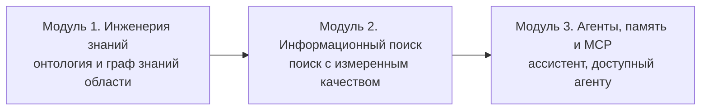

# От интеллектуального поиска к интеллектуальным агентам

Специальный курс магистратуры факультета вычислительной математики и кибернетики МГУ имени М. В. Ломоносова. Курс читается в осеннем семестре 2026 года.

Курс показывает, как превратить документы предметной области в знание, по которому можно искать, делать логический вывод и отвечать на вопросы исследователя. Студент представляет свою область онтологией и графом знаний, строит над ними поиск по словам, по смыслу и по связям, измеряет его качество и собирает из этих частей поискового ассистента, с которым работает агент на основе языковой модели.

## Авторы

- **Атаева О. М.**, кандидат технических наук, старший научный сотрудник ФИЦ «Информатика и управление» РАН
- **Халов А. П.**, аспирант МФТИ

## Для кого этот курс

Курс рассчитан на тех, кто работает или будет работать с инструментами анализа данных на основе искусственного интеллекта и обрабатывает большие массивы документов разных видов: тексты, формулы, таблицы, графы. Для курса нужны Python, основы линейной алгебры и теории вероятностей, желательно базовое понимание машинного обучения. Языки OWL, RDF и SPARQL и построение онтологий вводятся в курсе с начального уровня. Математика и естественные науки служат в курсе наглядными примерами, и все методы переносятся на любую область.

## Цели курса

Авторы ставят перед курсом пять целей.

1. Научить представлять предметную область онтологией и графом знаний и превращать неструктурированный корпус документов в граф знаний.
2. Научить строить над графом знаний многоуровневый поиск, в котором работают полнотекстовый, векторный, графовый и гибридный каналы поиска.
3. Научить измерять качество поиска на размеченной тестовой выборке и по измеренным числам выбирать и сочетать методы поиска.
4. Научить строить ответ языковой модели с опорой на поиск и проверять его по структурированному знанию.
5. Научить собирать из этих частей работающего ассистента на собственных данных, доступного программному агенту через протокол Model Context Protocol (MCP).

## Программа

Семестр состоит из трёх модулей, и каждый модуль добавляет к проекту новую функциональность.




### Модуль 1. Инженерия знаний

Переход от данных к знаниям: уровни представления знаний, логика и язык онтологий OWL, проектирование онтологии по вопросам исследователя, машина логического вывода и проверка данных, граф знаний в RDF и запросы SPARQL.

| Занятие | Тема | Шаг проекта |
|---|---|---|
| Лекция 1 | [От данных к знаниям: DIKW и архитектура сквозного проекта](lecture_1/) | подобласть, корпус от 30 утверждений, пять вопросов исследователя, репозиторий |
| Лекция 2 | [Основы логики и язык OWL: от высказываний к онтологии](lecture_2/) | онтология области с классами, свойствами и ограничениями |
| Лекция 3 | [Проектирование онтологии и автоматический вывод, практика по лекциям 1 и 2](lecture_3/) | вопросы к онтологии, машина вывода, проверка данных формами SHACL |
| Лекция 4 | [Графы знаний: RDF, SPARQL 1.1 и наполнение из текста](lecture_4/) | граф знаний в RDF, точка доступа SPARQL, извлечение утверждений из текста |

### Модуль 2. Информационный поиск

Поиск по корпусу четырьмя каналами, по словам, по смыслу, по структуре графа и их сочетанием, с измерением качества на размеченной выборке и генерацией ответа с проверкой.

| Занятие | Тема | Шаг проекта |
|---|---|---|
| Лекция 5 | [Классический полнотекстовый поиск: инвертированный индекс, BM25 и метрики](lecture_5/) | индекс BM25, тестовая выборка, метрики качества |
| Лекция 6 | [Векторный поиск: плотные векторные представления и приближённый поиск ближайших соседей](lecture_6/) | векторный индекс и сравнение с BM25 |
| Лекция 7 | Графовый поиск и GraphRAG: поиск по структуре графа | графовый поиск и GraphRAG |
| Лекция 8 | Гибридный поиск и RAG с проверкой | гибридный поиск, переранжирование, ответ с проверкой |

### Модуль 3. Агенты, память и Model Context Protocol

Агент на основе языковой модели сам вызывает инструменты поиска, хранит память между сессиями и подключается к системе через стандартный протокол.

| Занятие | Тема | Шаг проекта |
|---|---|---|
| Лекция 9 | Агенты на основе языковых моделей: ReAct, вызов инструментов и планирование | агент ReAct над своим поиском |
| Лекция 10 | Память агентов: классификация, архитектуры и управление контекстом | память агента, которая сохраняется между сессиями |
| Лекция 11 | Model Context Protocol: стандартный интерфейс между агентом и инструментом | MCP-сервер над графом знаний |

## Сквозной проект

На первой лекции студент выбирает узкую подобласть своей науки и за семестр собирает над ней поискового ассистента, от формальной онтологии до MCP-сервера с агентом. Итоговая система по вопросу на естественном языке находит относящиеся к нему научные утверждения, отвечает связно, ссылается на узлы графа знаний и доступна агенту через интерфейс MCP. Все результаты проекта хранятся в git-репозитории студента.

Примеры тем из программы курса:

- **Математика.** Ассистент по теории групп с графом зависимостей между теоремами, леммами и определениями раздела и с поиском по вопросу, от каких лемм зависит теорема.
- **Физика.** Ассистент по специальной теории относительности, в графе знаний которого есть 4-векторы, преобразования, уравнения и единицы измерения.
- **Научная литература.** GraphRAG по 40–60 статьям узкой темы с графом статей, понятий, методов и наборов данных и с поиском методов для заданной задачи.
- **Прикладная область.** Ассистент по корпусу стандартов или учебника своей области с понятиями и связями «использует» и «зависит от».

На занятиях все методы показываются на одном сквозном примере, задаче редактора научного сборника. У редактора есть положение о рецензировании, журнал рецензий по восьми статьям и утверждения математической статьи P2. Редактору нужно решить, какие статьи можно выносить на решение и на какие пункты положения опирается каждое требование. Поиск по словам и по смыслу дополнительно разбирается на 360 строфах «Евгения Онегина».

## Как устроены занятия

Каждое занятие состоит из лекции с мини-практикой. К занятию прилагаются слайды, блокнот демонстрации с данными и статья недели с указанием разделов для чтения. Домашнее задание переносит материал занятия на предметную область студента, и задания складываются в сквозной проект. Образец выполненных заданий на маленькой учебной области лежит в [`lecture_3/starter`](lecture_3/starter/).

Объём курса составляет 3 зачётные единицы: 36 часов занятий с преподавателем и 72 часа самостоятельной работы.

## Как начать

```bash
git clone https://github.com/iroli/IntelligentSearch2IntelligentAgents.git
cd IntelligentSearch2IntelligentAgents
pip install -r requirements.txt     # Python 3.8 и новее
java -version                        # Java нужна машине вывода Pellet на занятиях об онтологиях
python3 -m notebook                  # открыть блокнот нужного занятия
```

Блокноты выполняются сверху вниз из папки своего занятия. Ячейки, которым нужна языковая модель, без неё печатают сохранённую запись ответа, и инструменты при этом работают по-настоящему. Как подключить модель, описано в [README практики](lecture_3/README.md). Блокнот лекции 6 при первом запуске скачивает три модели векторизации, всего около 3 ГБ.
