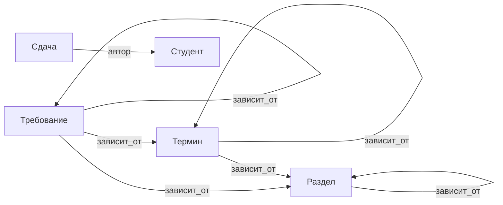
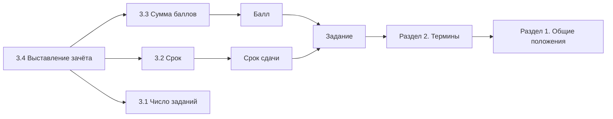

# Карта знаний: правила зачёта

**Типы сущностей.** Раздел: часть документа. Термин: определяемое понятие. Требование: норма, которую можно проверить по ведомости. Студент: слушатель курса. Сдача: строка ведомости о сданном задании.

**Типы связей.** `зависит_от` (Положение → Положение, транзитивная). `автор` (Сдача → Студент, у сдачи один автор). `балл` (Сдача → число).

Схема типов:

Фрагмент с экземплярами:

Обозначения и единицы. Балл: целое число от 0 до 25 за одно задание. Срок и дата сдачи: дата в формате ГГГГ-ММ-ДД. Пустая дата сдачи означает, что задание не сдано.
